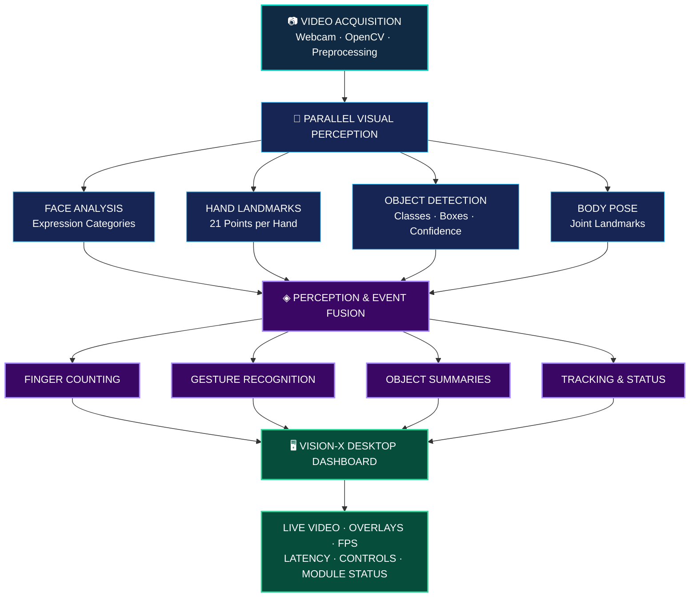
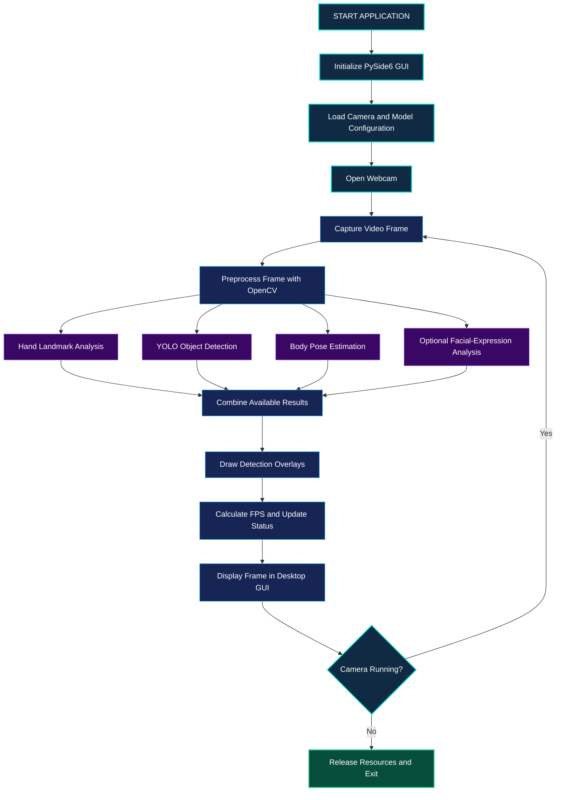

<div align="center">


### ARTIFICIAL INTELLIGENCE · VISUAL PERCEPTION · REAL-TIME ANALYSIS

<p>
  
  
  
  
  
</p>

<h3>
  <code>SEE</code> &nbsp; ◈ &nbsp;
  <code>DETECT</code> &nbsp; ◈ &nbsp;
  <code>TRACK</code> &nbsp; ◈ &nbsp;
  <code>UNDERSTAND</code>
</h3>

<p>
  <strong>Giving machines the ability to see, interpret, and understand the visual world.</strong>
</p>

<p>
  VISION-X AI is a computer vision project designed to explore
  real-time human and object perception through facial analysis,
  hand landmark tracking, gesture recognition, object detection,
  and human pose estimation.
</p>

<br/>

<a href="#vision-x-visual-core">VISUAL CORE</a>
&nbsp; ◆ &nbsp;
<a href="#vision-x-intelligence">AI CAPABILITIES</a>
&nbsp; ◆ &nbsp;
<a href="#vision-x-pipeline">PERCEPTION PIPELINE</a>
&nbsp; ◆ &nbsp;
<a href="#vision-x-roadmap">ROADMAP</a>

</div>


---

<a id="vision-x-visual-core"></a>

<div align="center">

## ◈ VISION-X AI // VISUAL CORE

### A MACHINE PERCEPTION ENGINE


<p>
  
  
  
  
</p>

</div>

---

<a id="vision-x-intelligence"></a>

<div align="center">

## ◈ THE INTELLIGENCE LAYERS

| PERCEPTION MODULE | VISUAL INTELLIGENCE |
|:---|:---|
| FACE ANALYSIS | Facial landmarks and expression-related cues |
| HAND TRACKING | Hand landmarks and finger positions |
| GESTURE RECOGNITION | Interpreting hand movements and gestures |
| OBJECT DETECTION | Identifying and locating objects in a scene |
| HUMAN POSE ESTIMATION | Mapping body keypoints and posture |

</div>

---

<a id="vision-x-pipeline"></a>

<div align="center">

## ◈ FROM PIXELS TO PERCEPTION

`CAMERA INPUT` &nbsp; → &nbsp;
`FRAME PROCESSING` &nbsp; → &nbsp;
`AI INFERENCE` &nbsp; → &nbsp;
`VISUAL ANNOTATION` &nbsp; → &nbsp;
`REAL-TIME OUTPUT`

<br/>

**ONE VISUAL WORLD. MULTIPLE LAYERS OF INTELLIGENCE.**

</div>

---

<a id="vision-x-roadmap"></a>

<div align="center">

## ◈ VISION-X // DEVELOPMENT ROADMAP

`01` FOUNDATION &nbsp; ◆ &nbsp;
`02` DETECTION &nbsp; ◆ &nbsp;
`03` TRACKING &nbsp; ◆ &nbsp;
`04` MULTIMODAL INTEGRATION &nbsp; ◆ &nbsp;
`05` OPTIMIZATION

<br/>

<sub>VISION-X AI — EXPLORING THE NEXT LAYER OF MACHINE PERCEPTION</sub>

</div>


# <u>01. INTRODUCTION</u>

### ◈ From Pixels to Intelligent Perception

Computer vision is one of the most important fields of artificial intelligence, enabling machines to interpret and analyze visual information from cameras and images. Modern vision systems can detect objects, track body movements, analyze visible facial expressions, and recognize hand gestures in real time.

However, many simple applications focus on only one task. A facial-expression classifier cannot count raised fingers, while a basic object detector cannot independently determine which gesture a person is performing.

**VISION-X AI addresses this limitation by integrating multiple computer-vision modules into one unified perception platform.**

The system uses a webcam as its primary input device and processes video frames locally on a Windows 11 computer. Specialized models analyze each frame to identify facial-expression categories, locate hands and anatomical landmarks, count raised fingers, recognize selected gestures, detect everyday objects, and estimate body posture.

The results are combined in a desktop dashboard displaying the camera feed, detection overlays, system status, and performance statistics.

<div align="center">

| CORE PRINCIPLE | DESIGN APPROACH |
|:---:|:---|
| **MODULARITY** | Independent, extensible perception modules |
| **REAL-TIME** | Continuous webcam frame analysis |
| **ACCESSIBILITY** | CPU-compatible implementation target |
| **PRIVACY** | Local processing by design |
| **EXTENSIBILITY** | Foundation for future AI capabilities |

</div>

> **Scientific note:** Facial-expression recognition estimates visible expression categories. It does not reliably establish a person's actual emotional state, intentions, or internal feelings.

---

# <u>02. PROJECT OBJECTIVES</u>

### ◈ Engineering Goals & Intelligence Capabilities

The primary objective is to develop a complete real-time visual perception system integrating the following capabilities.

<div align="center">

| ID | PERCEPTION MODULE | FUNCTIONAL OBJECTIVE |
|:---:|:---|:---|
| **01** | Facial-Expression Classification | Estimate categories such as happy, sad, angry, surprised, fearful, disgusted, and neutral, depending on the selected model |
| **02** | Hand Detection & Tracking | Locate visible hands and visualize anatomical landmarks |
| **03** | Finger Counting | Count zero to five raised fingers per hand, with support for two hands |
| **04** | Finger-Level Analysis | Analyze thumb, index, middle, ring, and little fingers |
| **05** | Gesture Recognition | Recognize selected static gestures, including thumbs-up, open palm, fist, and OK sign |
| **06** | Object Detection | Detect supported everyday objects, such as phones, bottles, cups, books, laptops, and people |
| **07** | Human Pose Estimation | Estimate body-joint landmarks and visualize posture |
| **08** | Desktop Visualization | Present camera frames, detection overlays, and system status in a professional interface |
| **09** | Performance & Reliability | Monitor CPU performance, handle errors, and maintain modular software components |
| **10** | Future Development | Enable temporal gesture recognition, hand-object interaction analysis, and custom AI models |

</div>

---

 

# <u>03. SYSTEM ARCHITECTURE</u>

<div align="center">

### ◈ THE MULTIMODAL PERCEPTION PIPELINE ◈

*From raw camera frames to structured visual intelligence.*

</div>



<div align="center">


</div>

### ◈ HOW THE MODULES WORK TOGETHER

Each perception module has a defined responsibility and produces structured output that can be consumed by the visualization layer or other components.

| MODULE | RECOMMENDED IMPLEMENTATION | OUTPUT |
|:---|:---|:---|
| **Camera Engine** | OpenCV | Video frames |
| **Face Analysis** | DeepFace or compatible expression model | Expression category and model score |
| **Hand Analysis** | MediaPipe Hands / Hand Landmarker | 21 landmarks per detected hand |
| **Finger Counting** | Geometric landmark rules | Estimated raised-finger count |
| **Gesture Recognition** | Landmark rules and optional classifier | Recognized gesture label |
| **Object Detection** | YOLO nano-sized model | Class, bounding box, confidence |
| **Body Pose** | MediaPipe Pose / Pose Landmarker | Body-joint coordinates |
| **Desktop Interface** | PySide6 / Qt | Interactive desktop application |
| **Performance Monitoring** | Python timing and OpenCV | FPS, latency, module status |

### ◈ CPU-FIRST PROCESSING STRATEGY

<div align="center">

| PROCESSING LAYER | STRATEGY |
|:---|:---|
| **Frame Acquisition** | Continuously capture webcam frames |
| **Lightweight Analysis** | Run inexpensive landmark calculations frequently |
| **Neural Inference** | Schedule heavier models at controlled intervals |
| **Visualization** | Display the latest available results |
| **Performance Control** | Measure latency and adapt inference frequency |

</div>

> **Engineering principle:** Every module does not need to run at full speed on every frame. Scheduling expensive inference separately from lightweight tracking can improve responsiveness on CPU-only systems. Actual performance depends on the selected models and hardware.

---


# <u>04. TECHNOLOGIES & TOOLS</u>

<div align="center">

### ◈ THE TECHNOLOGY STACK ◈

*Computer vision · Machine learning · Desktop engineering*

<br/>


</div>

### ◈ CORE TECHNOLOGIES

<details>
<summary><strong>01 · Python — Primary Programming Language</strong></summary>

Python is the primary language for integrating the perception modules, coordinating frame processing, managing model inference, and implementing application logic.

**Responsibilities:** pipeline orchestration, data processing, error handling, performance measurement, and module integration.

</details>

<details>
<summary><strong>02 · OpenCV — Camera & Image Processing</strong></summary>

OpenCV provides the camera interface and image-processing foundation.

- Webcam acquisition and frame handling.
- Image resizing and color-space conversion.
- Drawing bounding boxes, landmarks, and labels.
- Measuring frame-processing time and calculating FPS.

</details>

<details>
<summary><strong>03 · MediaPipe — Hand & Pose Landmarks</strong></summary>

MediaPipe provides hand and body-pose landmark estimation through compatible task or solution APIs.

- Hand landmark visualization.
- Finger-state estimation from landmark geometry.
- Rule-based static gesture recognition.
- Body-joint localization and pose visualization.

</details>

<details>
<summary><strong>04 · YOLO & PyTorch — Object Detection</strong></summary>

A compatible, lightweight YOLO model can detect supported object categories and return their locations and confidence scores. PyTorch may be used by the selected model implementation.

- Object classification.
- Bounding-box generation.
- Confidence-score reporting.
- Adjustable inference frequency for CPU operation.

</details>

<details>
<summary><strong>05 · DeepFace — Facial-Expression Analysis</strong></summary>

DeepFace can serve as an optional facial-analysis component when a compatible expression-analysis model is selected.

The expression module is separate from hand tracking and object detection, and may require additional model weights and dependencies.

</details>

<details>
<summary><strong>06 · PySide6 / Qt — Desktop Interface</strong></summary>

PySide6 provides the foundation for a desktop application with an interactive graphical interface.

- Live camera preview.
- Detection overlays and result panels.
- Start/stop controls and module status.
- FPS and latency indicators.
- Error messages and configuration options.

</details>

### ◈ TECHNOLOGY RESPONSIBILITY MATRIX

| TECHNOLOGY | PRIMARY ROLE | PROJECT LAYER |
|:---|:---|:---|
| Python | Application logic and integration | Core |
| OpenCV | Video acquisition and image processing | Input |
| MediaPipe | Hand and body landmarks | Perception |
| YOLO | Object detection | Perception |
| PyTorch | Model execution, where applicable | AI Runtime |
| DeepFace | Optional facial-expression analysis | Perception |
| PySide6 / Qt | Desktop interface | Presentation |

---

<div align="center">


VISION-X AI // SYSTEM DESIGN

MODULAR ARCHITECTURE. MULTIPLE PERCEPTION MODELS. ONE UNIFIED INTERFACE.

<sub>DESIGNED FOR EXTENSIBILITY, CPU-AWARE PROCESSING, AND REAL-TIME VISUALIZATION</sub>

</div>


 

# <u>05. DEVELOPMENT ENVIRONMENT</u>

<div align="center">

### ◈ ENGINEERING THE VISION-X AI WORKSPACE ◈

*Windows · Python · CPU-Based Inference · Desktop Intelligence*

<br/>


</div>

### ◈ TARGET CONFIGURATION

| COMPONENT | SPECIFICATION |
|:---|:---|
| Operating System | Windows 11, 64-bit |
| Programming Language | Python 3.11, 64-bit |
| Processing Hardware | CPU-only execution |
| Visual Input | Built-in or external USB webcam |
| User Interface | Desktop graphical interface |
| Network Requirement | Initial package and model downloads |
| Runtime Processing | Local inference after dependencies and weights are available |

### ◈ STEP 01 — INITIALIZE THE PROJECT

Open PowerShell and create the project workspace.

```powershell
mkdir VISION-X-AI
cd VISION-X-AI

mkdir src
mkdir models
mkdir assets
mkdir tests
```

### ◈ STEP 02 — CREATE THE VIRTUAL ENVIRONMENT

```powershell
py -3.11 -m venv .venv

.\.venv\Scripts\Activate.ps1

python -m pip install --upgrade pip
```

If PowerShell blocks environment activation, use the following command in the current PowerShell session:

```powershell
Set-ExecutionPolicy -Scope Process Bypass

.\.venv\Scripts\Activate.ps1
```

<details>
<summary><strong>◈ ENVIRONMENT CHECK — VERIFY PYTHON</strong></summary>

```powershell
python --version
python -c "import sys; print(sys.executable)"
python -m pip --version
```

The Python version should be 3.11.x, and the executable path should point to the project's `.venv` directory.

</details>

### ◈ STEP 03 — INSTALL THE CORE DEPENDENCIES

Create a file named `requirements.txt` in the project root.

```text
numpy>=1.26,<2.0
opencv-python>=4.9,<5
mediapipe==0.10.21
PySide6>=6.7,<7
ultralytics>=8.3,<9
```

Install the required packages:

```powershell
python -m pip install -r requirements.txt
```

<div align="center">

| PACKAGE | ROLE IN VISION-X AI |
|:---|:---|
| `numpy` | Numerical operations and array processing |
| `opencv-python` | Webcam input and image processing |
| `mediapipe` | Hand and body-pose landmarks |
| `PySide6` | Desktop interface |
| `ultralytics` | YOLO object-detection integration |

</div>

> **Reproducibility note:** These version constraints are a starting point, not a guarantee of compatibility with every future release. Record the exact package versions that successfully install and run on your machine before publishing a research release.

---


# <u>06. CORE APPLICATION IMPLEMENTATION</u>

<div align="center">

### ◈ FROM SOURCE CODE TO LIVE PERCEPTION ◈

*Camera acquisition · Visual inference · Result rendering · Performance monitoring*

</div>

### ◈ APPLICATION OVERVIEW

The core application brings the primary perception components together in a runnable desktop application. Its purpose is to establish the first functional implementation before further modularization and testing.

<div align="center">

| CAPABILITY | IMPLEMENTATION STATUS IN THE DESCRIBED DESIGN |
|:---|:---|
| Live webcam preview | Core application feature |
| Hand landmarks | MediaPipe-based processing |
| Approximate finger counting | Geometric landmark heuristics |
| Static gesture classification | Limited rule-based recognition |
| Object detection | YOLO-based inference |
| Body-pose landmarks | MediaPipe Pose |
| Facial-expression estimation | Optional DeepFace integration |
| FPS monitoring | Frame timing |
| Camera controls | Desktop interface |
| CPU inference | Intended execution mode |

</div>

### ◈ APPLICATION PROCESSING FLOW



### ◈ SOURCE CODE ORGANIZATION

For the first release described in your implementation, create `app.py` in the project root:

```text
VISION-X-AI/
│
├── .venv/
├── src/
├── models/
├── assets/
├── tests/
│
├── app.py
├── requirements.txt
└── README.md
```

The source excerpt supplied in the project description begins with imports and configuration, but the complete application implementation was not included in that excerpt. Therefore, this section documents the intended structure and execution flow without claiming that a complete runnable source file is present here.

### ◈ CORE CONFIGURATION REFERENCE

| PARAMETER | VALUE | PURPOSE |
|:---|:---|:---|
| `CAMERA_WIDTH` | `640` | Requested camera-frame width |
| `CAMERA_HEIGHT` | `480` | Requested camera-frame height |
| `OBJECT_MODEL` | `yolov8n.pt` | Initial lightweight object-detection model |
| `OBJECT_CONFIDENCE` | `0.35` | Example detection-confidence threshold |
| `OBJECT_IMAGE_SIZE` | `416` | Configured model input image size |
| `EMOTION_INTERVAL_SECONDS` | `2.0` | Interval between optional expression-analysis requests |

<sub>These values reflect the configuration excerpt provided for the project; actual runtime behavior depends on how the complete application uses them.</sub>

---


# <u>07. RUNNING THE APPLICATION</u>

<div align="center">

### ◈ LAUNCH THE VISUAL INTELLIGENCE CONSOLE ◈

</div>

### STEP 01 — ACTIVATE THE ENVIRONMENT

Open PowerShell in the project directory:

```powershell
cd VISION-X-AI
.\.venv\Scripts\Activate.ps1
```

### STEP 02 — START VISION-X AI

```powershell
python app.py
```

The application is expected to initialize the desktop window and camera. On the first run, the YOLO model may download its pretrained weights if they are not already available locally.

### STEP 03 — TEST THE PERCEPTION MODULES

<div align="center">

| ACTION | EXPECTED OBSERVATION |
|:---|:---|
| Select camera index `0` | Default webcam selected |
| Enable object detection | Supported objects may receive bounding boxes |
| Enable body-pose estimation | Visible body landmarks may be rendered |
| Press **START CAMERA** | Live video processing begins |
| Show one or both hands | Hand landmarks may appear |
| Raise different fingers | Approximate finger counts are displayed |
| Present supported objects | Object classes and confidence scores may appear |
| Monitor the status panel | FPS and module status can be observed |

</div>

### ◈ CAMERA TROUBLESHOOTING

If the webcam does not open:

1. Open **Windows Settings → Privacy & security → Camera**.
2. Confirm camera access is enabled for desktop applications.
3. Close other applications that may be using the webcam.
4. Try camera index `1` if index `0` fails.
5. Verify that the camera is detected by Windows.

---

# <u>08. OPTIONAL FACIAL-EXPRESSION MODULE</u>

<div align="center">

### ◈ EXTENDING THE PERCEPTION PIPELINE ◈


</div>

The facial-expression component is optional because it introduces additional dependencies, model weights, and computational overhead.

### STEP 01 — INSTALL DEEPFACE

```powershell
python -m pip install deepface
```

### STEP 02 — CONFIGURE THE APPLICATION

Restart the application and enable **Enable facial-expression estimates**, if this control is implemented in the completed source code.

The first inference may require downloading additional model weights. If installation or model initialization fails, the remaining perception modules can still operate if the application handles the optional component's failure correctly.

> **Scientific limitation:** Facial-expression estimates describe model-predicted visible expression categories. They should not be interpreted as definitive measurements of a person's internal emotions or intentions.

---


# <u>09. INITIAL RELEASE — SCOPE & LIMITATIONS</u>

<div align="center">

### ◈ BUILD · TEST · MEASURE · IMPROVE ◈

</div>

| AREA | INITIAL IMPLEMENTATION | FUTURE IMPROVEMENT |
|:---|:---|:---|
| Finger counting | Geometric heuristics | Robustness across orientations and occlusion |
| Gesture recognition | Limited static vocabulary | Dedicated OK-sign recognition and temporal gestures |
| Object detection | Pretrained YOLO model | Custom classes and model evaluation |
| Facial analysis | Optional model integration | Performance and robustness evaluation |
| Hand-object interaction | Not yet implemented | Associate detected objects with hand positions |
| Action recognition | Not yet implemented | Temporal analysis across consecutive frames |
| Performance | FPS monitoring | Benchmark latency and CPU utilization |
| Software structure | Single-file first release | Separate modules, tests, and configuration |

<div align="center">

### <u>VISION-X AI</u>

**ONE CAMERA. MULTIPLE MODELS. A UNIFIED VISUAL PERCEPTION SYSTEM.**

<sub>WINDOWS 11 · PYTHON 3.11 · CPU-AWARE COMPUTER VISION</sub>

</div>


